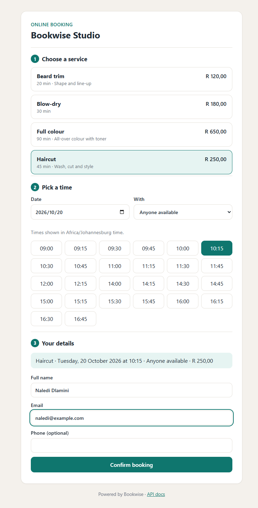
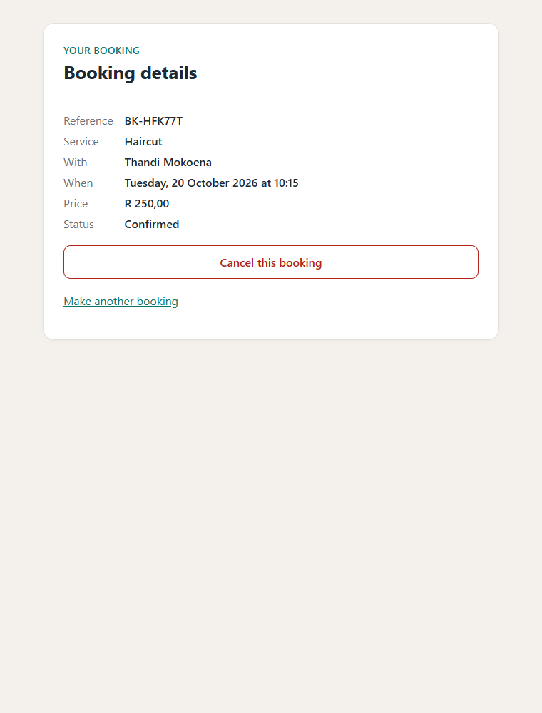
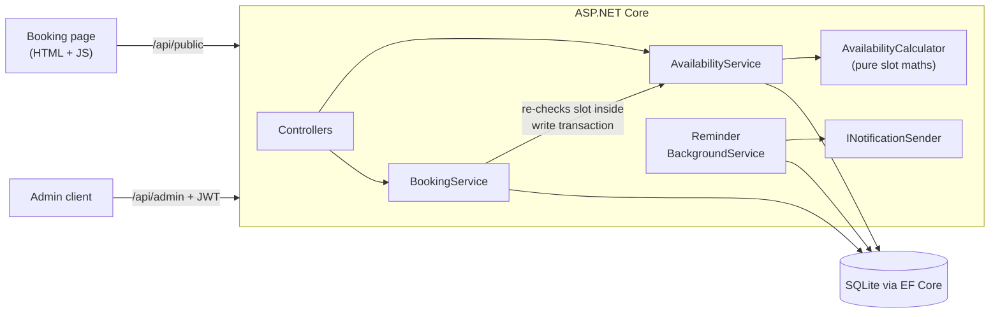

# Bookwise

[](https://github.com/Pierce-Robinson/bookwise/actions/workflows/ci.yml)

Online appointment booking for service businesses such as salons, physios and consultants. Built with **C#, ASP.NET Core 10 and EF Core**, with a customer booking page in plain JavaScript.

Customers pick a service, see real free times and book in a few clicks. Staff manage services, schedules and time off through an admin API.

<p>
  
  
</p>

## Features

- **Live availability**: free slots are calculated from each staff member's working hours (including split shifts), service length, existing bookings and time off
- **No double bookings**: the availability check and the insert run in one write transaction, with a unique database index as a second line of defence. Proven by a test that fires 8 simultaneous requests at one slot
- **Time zones done properly**: working hours are local (Africa/Johannesburg by default); everything is stored in UTC; daylight-saving gaps and overlaps are handled for businesses in zones that use them
- **"Anyone available"**: when the customer doesn't choose, the booking goes to whoever has the fewest appointments that day
- **Self-service**: customers get a private link to view or cancel, up to a configurable cut-off (24 hours by default)
- **Reminders**: a background service sends each customer one reminder within 24 hours of their appointment
- **Admin API**: services, staff, weekly schedules, time off, the day sheet, and marking appointments completed or no-show
- **Protection**: JWT authentication for admin endpoints, per-IP rate limiting on public booking endpoints, cancel tokens stored only as SHA-256 hashes
- **Consistent errors**: RFC 9457 problem details with machine-readable codes such as `SLOT_UNAVAILABLE`

## Tech stack

| | |
| --- | --- |
| Language | C# 14, .NET 10 |
| Web | ASP.NET Core Web API (controllers), built-in rate limiting, problem details, health checks |
| Data | EF Core 10 with SQLite and migrations |
| Auth | JWT bearer tokens, ASP.NET Core Identity password hashing |
| Front end | HTML, CSS and vanilla JavaScript (no build step) |
| Docs | OpenAPI 3.1 with a Scalar API reference |
| Testing | xUnit, WebApplicationFactory, `FakeTimeProvider`: 34 tests |
| Delivery | Docker, GitHub Actions on Linux and Windows |

## How it fits together



### Design decisions

| Decision | Why |
| --- | --- |
| Slot maths is a pure static class | Every rule (breaks, overlaps, notice period, daylight saving) is unit tested without a database or clock |
| A booking must match a slot the calculator offered | The booking rules and the availability rules can never disagree, and off-grid or out-of-hours times are rejected automatically |
| Check and insert in one `BEGIN IMMEDIATE` transaction | SQLite takes the write lock up front, so two customers racing for a slot are serialised and only one wins |
| Unique filtered index on (staff, start) for confirmed bookings | A database-level safety net if application checks are ever bypassed |
| `TimeProvider` injected everywhere | Tests control "now" precisely, including moving the clock forward to test reminders |
| Cancel tokens are hashed, and wrong tokens return 404 | A database leak doesn't expose working cancel links, and booking references can't be probed |
| Price captured on the booking | Changing a service's price doesn't change existing appointments |

## Running it

Requires the [.NET 10 SDK](https://dotnet.microsoft.com/download).

```bash
dotnet run --project src/Bookwise.Api
```

Then open:

- **http://localhost:5080**: the customer booking page
- **http://localhost:5080/scalar**: interactive API docs

In development the app creates a SQLite database, a demo salon with three staff and four services, and an admin login: `admin@bookwise.local` / `Admin123!` (local only).

**With Docker:**

```bash
docker build -t bookwise .
docker run -p 8080:8080 -v bookwise-data:/data \
  -e Jwt__Key="a-long-random-secret-of-at-least-32-chars" \
  -e Seed__AdminPassword="choose-a-password" \
  -e Seed__DemoData=true \
  bookwise
```

## API overview

| Method | Path | Auth | Description |
| --- | --- | --- | --- |
| GET | `/api/public/services` | none | Services and who offers them |
| GET | `/api/public/availability?serviceId=&date=&staffId=` | none | Free slots on a local date |
| POST | `/api/public/bookings` | none (rate limited) | Book a slot; returns reference and cancel token |
| GET | `/api/public/bookings/{reference}?token=` | token | View a booking |
| POST | `/api/public/bookings/{reference}/cancel` | token | Cancel before the cut-off |
| POST | `/api/auth/login` | none | Admin login, returns a JWT |
| GET, POST, PUT, DELETE | `/api/admin/services` | JWT | Manage services |
| GET, POST, DELETE | `/api/admin/staff` | JWT | Manage staff |
| PUT | `/api/admin/staff/{id}/working-hours` | JWT | Replace the weekly schedule |
| PUT | `/api/admin/staff/{id}/services` | JWT | Assign services |
| POST, DELETE | `/api/admin/staff/{id}/time-off` | JWT | Block out time |
| GET | `/api/admin/bookings?date=` | JWT | The day sheet |
| POST | `/api/admin/bookings/{id}/cancel`, `/complete`, `/no-show` | JWT | Record what happened |

Example error:

```json
{
  "title": "Business rule violated",
  "status": 409,
  "detail": "That time is not available. Please choose another slot.",
  "code": "SLOT_UNAVAILABLE"
}
```

## Tests

```bash
dotnet test
```

34 tests covering:

- **Slot maths**: working hours, lunch breaks, overlaps, notice periods, and daylight-saving edge cases using London's clock changes
- **The full API** through `WebApplicationFactory` on a real SQLite file, with a fake clock
- **Concurrency**: 8 simultaneous bookings for one slot produce exactly one booking
- **Reminders**: sent once, only within 24 hours, never for cancelled bookings
- **Security**: auth on admin endpoints, rate limiting, cancel-token checks

CI runs the suite on **Linux and Windows** and checks the Docker image builds.

## Configuration

All settings live in `appsettings.json` and can be overridden with environment variables (for example `Business__TimeZoneId`).

| Setting | Default | Purpose |
| --- | --- | --- |
| `Business:TimeZoneId` | `Africa/Johannesburg` | Zone that working hours are in |
| `Business:SlotIntervalMinutes` | `15` | Spacing of offered start times |
| `Business:MinimumNoticeMinutes` | `60` | How soon a booking can start |
| `Business:MaxDaysAhead` | `60` | How far ahead customers can book |
| `Business:CancellationCutoffHours` | `24` | Online cancellation cut-off |
| `Business:ReminderLeadHours` | `24` | When reminders go out |
| `Business:PublicRateLimitPerMinute` | `20` | Booking requests per IP per minute |
| `Jwt:Key` | none (required) | JWT signing key, 32+ characters |
| `Seed:AdminEmail`, `Seed:AdminPassword` | | First admin account, created on an empty database |

## License

[MIT](LICENSE)
